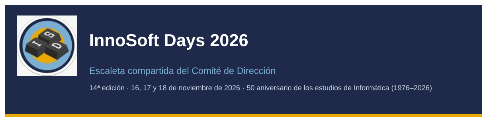
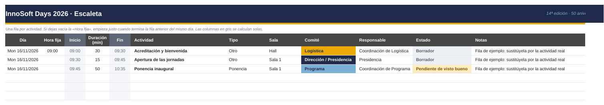
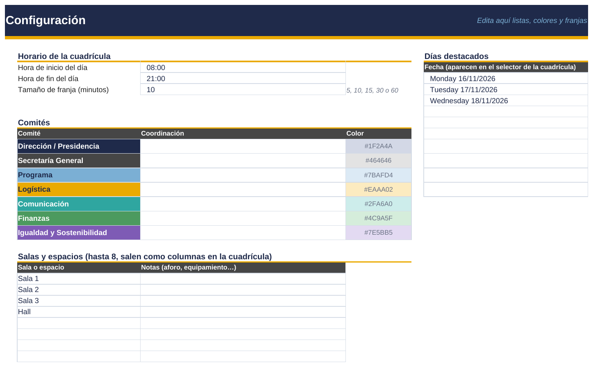

# InnoSoft Days 2026 · Escaleta compartida

Plantilla de Google Sheets para organizar las **InnoSoft Days 2026** (14ª edición, 16 a 18 de noviembre) entre todos los comités. Incluye un script gratuito que copia cada actividad a un **Google Calendar compartido**, para que todo el mundo la tenga en el móvil con avisos.

La idea es sencilla: **la escaleta es la única fuente de verdad**. Todo se escribe en la hoja y el calendario se actualiza solo.

- [Para coordinadores: cómo usar la escaleta](#para-coordinadores-cómo-usar-la-escaleta)
- [Ver la escaleta en tu calendario](#ver-la-escaleta-en-tu-calendario)
- [Para quien la monta (una sola vez)](#para-quien-la-monta-una-sola-vez)
- [Personalizar](#personalizar)
- [Problemas frecuentes](#problemas-frecuentes)

## Qué hay en este repositorio

| Archivo | Para qué sirve |
|---|---|
| `Escaleta_InnoSoft_Days_2026.xlsx` | La plantilla. Se sube a Google Drive y se convierte a Google Sheets. |
| `apps-script/sincronizar-calendar.gs` | El script que pasa la escaleta a Google Calendar. |
| `docs/` | Capturas usadas en este README. |

La hoja tiene cuatro pestañas:

| Pestaña | Contenido |
|---|---|
| **Cómo se usa** | Resumen rápido y leyenda de colores de comités y estados. |
| **Escaleta** | La lista maestra: una fila por actividad, reunión o plazo. Es lo único que se edita a diario. |
| **Cuadrícula** | Vista de un día con una columna por sala, en franjas de 5 a 60 minutos. Se rellena sola. |
| **Configuración** | Comités, coordinación, salas, estados, tipos de actividad y horario del día. |

---

## Para coordinadores: cómo usar la escaleta

No tienes que instalar nada. Solo necesitas el enlace a la escaleta que te ha pasado Presidencia y una cuenta de Google.

### 1. Añade una actividad

Ve a la pestaña **Escaleta** y rellena una fila vacía:

| Columna | Qué poner |
|---|---|
| **Día** | La fecha, por ejemplo `16/11/2026`. |
| **Hora fija** | Solo si la actividad tiene que empezar a una hora concreta (ver el paso 2). |
| **Duración (min)** | Minutos exactos: `7`, `20`, `45`… |
| **Actividad** | Nombre corto y claro. Es lo que se verá en el calendario. |
| **Tipo** | Desplegable: ponencia, taller, mesa redonda, pausa, reunión… |
| **Sala** | Desplegable con las salas de Configuración. |
| **Comité** | Tu comité. Colorea la fila y el evento del calendario. |
| **Responsable** | Quién se encarga de que salga bien. |
| **Estado** | `Borrador`, `Pendiente de visto bueno`, `Confirmada` o `Cancelada`. |
| **Notas** | Todo el detalle: material, ponente, contacto, qué hay que preparar… |

Las columnas en gris (**Inicio**, **Fin** y **Aviso**) se calculan solas. No las escribas a mano.

### 2. Cuadra las horas al minuto

- La **primera actividad del día** lleva Hora fija (por ejemplo `09:00`).
- Las siguientes **dejan la Hora fija vacía** y empiezan justo cuando termina la fila anterior del mismo día.
- Si cambias una duración, **todo lo que va detrás se mueve solo**.
- Si algo tiene que empezar sí o sí a una hora (una comida, una ponencia con horario cerrado), ponle Hora fija y la cadena sigue desde ahí.

> El encadenado sigue el **orden de las filas**. Mantén cada día en filas seguidas y en orden.

### 3. Sigue el circuito de estados

| Estado | Cuándo usarlo |
|---|---|
| `Borrador` | Idea en preparación, aún no se ha propuesto. |
| `Pendiente de visto bueno` | Propuesta enviada a Presidencia. |
| `Confirmada` | Aprobada y lista para anunciar. |
| `Cancelada` | No se hace. Se queda en la hoja para el historial pero libera la sala y sale del calendario. |

Solo Presidencia pasa una actividad a `Confirmada`.

### 4. Revisa la cuadrícula y los avisos

- En **Cuadrícula**, cambia el día en la celda amarilla y verás cada sala como una columna, con los bloques del color de cada comité.
- Si dos actividades no canceladas coinciden en la misma sala, la columna **Aviso** de la Escaleta lo marca en rojo. Habla con el otro comité antes de cambiar nada.

### 5. Normas para no romperla

- **No ordenes la hoja** con *Datos > Ordenar intervalo*: rompería el encadenado de horas. Para ver solo lo tuyo usa *Datos > Crear vista de filtro*, que no afecta a los demás.
- **No toques** las columnas grises ni la columna **ID evento (no tocar)**.
- Para **intercalar** una actividad entre dos filas, inserta la fila y rellena sus fórmulas: selecciona las celdas de Inicio de la fila de arriba y de la nueva y pulsa `Ctrl+D` (`Cmd+D` en Mac); repite con Fin y Aviso. Si añades al final no hace falta.
- Para preguntar algo sobre una actividad, deja un **comentario** en la celda mencionando a la persona con `@`. Le llegará un correo.
- Los cambios se hacen **siempre en la hoja**, nunca en el calendario. Lo que edites en el calendario se sobrescribe en la siguiente sincronización.

---

## Ver la escaleta en tu calendario

Cada actividad aparece en el calendario **InnoSoft Days 2026** con la sala como ubicación y el comité, el responsable, el estado y las notas en la descripción. Lo que no está confirmado lleva `[Borrador]` o `[Pendiente]` delante del título. Se actualiza cada 15 minutos.

### Si usas Google Calendar

1. Abre el correo «Se ha compartido contigo el calendario InnoSoft Days 2026» y pulsa **Añadir este calendario**.
2. En el móvil, abre la app de Google Calendar, ve a *Ajustes*, entra en tu cuenta y comprueba que **InnoSoft Days 2026** está marcado para que se sincronice.
3. Si quieres avisos, en la web ve a *Configuración > InnoSoft Days 2026 > Notificaciones de eventos* y añade, por ejemplo, un aviso 30 minutos antes.

### Si usas Apple Calendar u Outlook

Pide el **enlace iCal** a quien montó la escaleta y suscríbete:

- **Apple Calendar (Mac):** *Archivo > Nueva suscripción a calendario* y pega el enlace.
- **iPhone:** *Ajustes > Calendario > Cuentas > Añadir cuenta > Otra > Añadir calendario suscrito*.
- **Outlook:** *Agregar calendario > Suscribirse desde la web* y pega el enlace.

Estas apps refrescan los calendarios suscritos cada varias horas, así que los cambios de última hora pueden tardar en aparecer.

---

## Para quien la monta (una sola vez)

Esto lo hace **una sola persona** (Presidencia, Vicepresidencia o Secretaría). Lo ideal es usar una **cuenta de Google del evento** y no una personal, para poder pasársela a la siguiente edición.

### Paso 1. Sube la plantilla a Google Sheets

1. Descarga `Escaleta_InnoSoft_Days_2026.xlsx` de este repositorio (botón *Download raw file*).
2. Súbela a Google Drive y ábrela con **Hojas de cálculo de Google**.
3. Ve a *Archivo > Guardar como Hojas de cálculo de Google*. A partir de aquí trabaja siempre en esa copia.
4. Ve a *Archivo > Configuración* y comprueba que la **configuración regional es España** y la **zona horaria es (GMT+01:00) Madrid**.

### Paso 2. Personaliza la configuración

En la pestaña **Configuración**:

1. Escribe la **coordinación** de cada comité.
2. Sustituye `Sala 1`, `Sala 2`, `Sala 3` y `Hall` por los **espacios reales** (hasta 8).
3. Revisa el **horario del día** (inicio, fin y tamaño de franja de la cuadrícula).
4. Añade en **Días destacados** las fechas que quieras tener a mano en el selector de la cuadrícula.

Después, en la **Escaleta**, borra las tres filas de ejemplo (selecciona las celdas de Día a Notas y pulsa *Suprimir*; no borres las filas enteras).

### Paso 3. Instala el script del calendario

1. En la hoja, ve a *Extensiones > Apps Script*.
2. Borra el código que aparece y pega el contenido de [`apps-script/sincronizar-calendar.gs`](apps-script/sincronizar-calendar.gs). Pulsa **Guardar**.
3. En el menú izquierdo, entra en *Configuración del proyecto* (la rueda) y pon la **zona horaria** en `(GMT+01:00) Hora central europea - Madrid`.
4. Vuelve al *Editor*, elige la función **`configurarTodo`** en el desplegable de arriba y pulsa **Ejecutar**.
5. Google pedirá permisos para Hojas de cálculo y Calendar. Saldrá el aviso *«Google no ha verificado esta aplicación»* porque el script es tuyo y no está publicado: pulsa *Configuración avanzada > Ir a … (no seguro)* y acepta.
6. Al terminar, el script:
   - crea el calendario **InnoSoft Days 2026**,
   - pasa todas las actividades no canceladas,
   - programa la sincronización automática cada 15 minutos,
   - y añade el menú **InnoSoft** en la hoja, con *Sincronizar con Google Calendar ahora*.

### Paso 4. Comparte la hoja y el calendario

1. **La hoja:** botón *Compartir*, añade los correos de los coordinadores con permiso de **Editor**.
2. **El calendario:** en Google Calendar, pasa el ratón por *InnoSoft Days 2026* y ve a *Opciones > Configuración y uso compartido > Compartir con determinadas personas o grupos*. Añade a los coordinadores con el permiso **Ver todos los detalles de los eventos**, no con permiso de edición: los cambios se hacen en la hoja.
3. **Enlace iCal** (para quien no use Google Calendar): en esa misma página, en *Integrar el calendario*, copia la **Dirección secreta en formato iCal**. Compártela solo con los coordinadores, porque quien la tenga puede ver el calendario.

### Paso 5. Comprueba que funciona

1. Añade una actividad de prueba en la Escaleta y pulsa *InnoSoft > Sincronizar con Google Calendar ahora*.
2. Mira que aparece en el calendario con la hora y la sala correctas.
3. Cambia su duración, vuelve a sincronizar y comprueba que el evento se mueve.
4. Ponla en `Cancelada`, sincroniza y comprueba que desaparece.

---

## Personalizar

| Quiero… | Cómo |
|---|---|
| Franjas más finas en la cuadrícula | *Configuración > Tamaño de franja*: 5, 10, 15, 30 o 60 minutos. |
| Añadir o renombrar una sala | *Configuración > Salas y espacios*. Aparece sola en los desplegables y en la cuadrícula. |
| Cambiar el color o el nombre de un comité | Cambia el nombre en *Configuración* y ajusta las reglas en *Formato > Formato condicional* de las pestañas Escaleta y Cuadrícula. En el calendario, cambia `colorPorComite` al principio del script. |
| Que solo pasen al calendario las actividades confirmadas | En el script, deja `estadosSincronizados: ['Confirmada']`. |
| Sincronizar más o menos a menudo | Cambia `minutosEntreSincronizaciones` (1, 5, 10, 15 o 30) y vuelve a ejecutar `configurarTodo`. |
| Más de 500 actividades | Arrastra hacia abajo las fórmulas de Inicio, Fin y Aviso, y amplía los rangos que terminan en la fila 504. |

## Problemas frecuentes

| Problema | Solución |
|---|---|
| Inicio y Fin salen vacíos | Falta el Día o la Duración, o la fila anterior del mismo día no tiene Fin. Pon una Hora fija para arrancar la cadena. |
| La hora del calendario no coincide con la hoja | Revisa que la hoja (*Archivo > Configuración*) y el script (*Configuración del proyecto*) están en la zona horaria de Madrid. |
| Una actividad no aparece en el calendario | Comprueba que tiene Día, Duración y Actividad, y que no está `Cancelada`. La sincronización automática puede tardar hasta 15 minutos. |
| Aparece el aviso de solape | Dos actividades no canceladas comparten sala y horario. Mueve una de las dos o cambia de sala. |
| Ordené la hoja y se han descolocado las horas | *Archivo > Historial de versiones* y restaura la versión anterior. Para filtrar usa vistas de filtro. |
| He editado un evento en el calendario y se ha deshecho | Es lo esperado: el calendario se genera desde la hoja. Haz el cambio en la Escaleta. |

## Licencia

[MIT](LICENSE). Úsala y adáptala para próximas ediciones de las jornadas.
